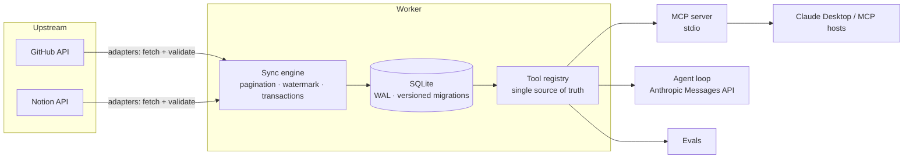

# Rockin Worker

[](https://github.com/BryantJavaInt/rockin-worker/actions/workflows/ci.yml)
[](LICENSE)


Created and maintained by [Bryant Giorgini](https://github.com/BryantJavaInt).

**Give an LLM agent a trustworthy, always-available view of your data — without letting it near your APIs.**

Rockin Worker syncs data from third-party APIs (GitHub, Notion) into a local SQLite store, then exposes that store to Claude two ways: as a [Model Context Protocol](https://modelcontextprotocol.io) (MCP) server for Claude Desktop and any MCP host, and through a built-in tool-use agent (`ask`). A small eval harness measures whether the agent picks the right tool, answers from real data, and resists prompt injection.



**Why this shape.** Tools only ever *read a local snapshot*. The agent stays fast, keeps working when an upstream API is down or rate-limited, cannot be talked into calling an API it shouldn't, and every answer carries an honest `lastSyncAt` freshness stamp.

## Quickstart

**Prerequisites:** Node.js ≥ 24 (`.nvmrc` provided; uses the built-in `node:sqlite`, so there are no native modules to compile) and at least one data-source credential:

- **GitHub** — a [personal access token](https://github.com/settings/tokens) with read access to your repositories.
- **Notion** — an [internal integration](https://www.notion.so/my-integrations) token; share the pages you want synced with that integration.
- **Anthropic** (only for `ask` / `eval`) — an API key from the [Console](https://console.anthropic.com/).

```bash
npm install
cp .env.example .env                        # then fill in your credentials

npm run sync                                # sync every configured source (incremental after the first run)
npm run tool -- github_getTopItems --limit 5   # call a tool locally — no LLM involved
npm run ask -- "Which of my repos has the most stars, and which Notion page did I edit last?"
npm run serve                               # MCP server on stdio
```

Tool arguments are passed as flags (`--limit 5`, `--query roadmap`) so they work the same in bash, PowerShell and cmd. A JSON object is also accepted where your shell allows it: `npm run tool -- github_getTopItems '{"limit":5}'`.

## Configuration

All configuration is environment variables, read from the process environment first and from `.env` second. Blank values count as unset.

| Variable | Default | Purpose |
| --- | --- | --- |
| `GITHUB_TOKEN` | — | Enables the GitHub source. |
| `NOTION_TOKEN` | — | Enables the Notion source. |
| `ANTHROPIC_API_KEY` | — | Required for `ask` and `eval`. |
| `VOYAGE_API_KEY` | — | Enables semantic search (embeddings come from Voyage AI; Anthropic has no embeddings API). |
| `EMBEDDING_MODEL` | `voyage-3.5-lite` | Embedding model. Changing it re-embeds everything on the next `embed`. |
| `SEMANTIC_MIN_SCORE` | `0.25` | Cosine-similarity floor for semantic matches. Scales differ per model — calibrate it. |
| `MCP_AUTH_TOKEN` | — | Bearer token for `serve --http` (at least 24 characters). Environment only, never a flag. |
| `MCP_HTTP_HOST` | `127.0.0.1` | Interface `serve --http` binds to (`--host` overrides). |
| `MCP_HTTP_PORT` | `8787` | Port for `serve --http` (`--port` overrides; `0` picks a free one). |
| `MCP_ALLOWED_ORIGINS` | — | Comma-separated browser origins allowed to call the HTTP server. Non-browser clients send no `Origin` and are unaffected. |
| `ANTHROPIC_MODEL` | `claude-haiku-4-5-20251001` | Model used by `ask` and `eval` (`--model` overrides it per call). |
| `DB_PATH` | `./data.db` | SQLite file. Use `:memory:` for a throwaway database. |
| `LOG_DIR` | `./logs` | Where `sync-history.jsonl` (one JSON line per sync run) is written. |
| `SYNC_MAX_PAGES` | `5` | Page budget per source per run. If it runs out before the data does, progress is saved and the next run resumes from the saved cursor. |

## Commands

| Command | What it does |
| --- | --- |
| `npm run sync` · `sync:github` · `sync:notion` | Sync all configured sources, or one. Append `-- --full` to ignore the watermark, re-sync everything and prune records deleted upstream, or `-- --every 15m` to keep running as a worker (stops gracefully on Ctrl+C / SIGTERM). Exits 1 if any source errored. |
| `npm run embed [-- github\|notion]` | Build or refresh the semantic-search index (needs `VOYAGE_API_KEY`). Incremental: only new or edited items are embedded. `sync --embed` does it right after a sync, and a worker does it every cycle once a key is set. |
| `npm run tool -- <name> [--flag value]` | Run one tool locally and print its JSON. Without a name it lists the available tools. |
| `npm run ask -- "<question>"` | Ask the Claude agent (tools run in-process). Tools used, tokens and latency go to stderr. |
| `npm run serve` | MCP server over stdio. Add `-- --http [--host h] [--port p]` for remote HTTP with bearer authentication. |
| `npm run eval` | End-to-end agent evals against fixture data. Needs `ANTHROPIC_API_KEY`; costs tokens. |
| `npm run check` | Everything CI runs: lint, typecheck, tests with a coverage floor. |
| `npm run build` | Compile to `dist/` (`node dist/main.js <command>`). |

Exit codes: `0` success · `1` runtime failure · `2` usage error.

### Use it from Claude Desktop

```bash
npm run build
```

```jsonc
// claude_desktop_config.json — use absolute paths (on Windows, escape backslashes: "C:\\Users\\you\\rockin-worker\\dist\\main.js")
{
  "mcpServers": {
    "rockin-worker": {
      "command": "node",
      "args": ["/absolute/path/to/rockin-worker/dist/main.js", "serve"],
      "env": { "DB_PATH": "/absolute/path/to/rockin-worker/data.db" }
    }
  }
}
```

Run `npm run sync` first — the server only serves what has been synced.

### Remote MCP over HTTP

For clients that are not on the same machine, the same tools are available over streamable HTTP with bearer-token authentication:

```bash
export MCP_AUTH_TOKEN="$(openssl rand -hex 32)"     # required, at least 24 characters
npm run serve -- --http --port 8787                 # binds to 127.0.0.1 by default
```

```bash
curl -s http://127.0.0.1:8787/mcp \
  -H "Authorization: Bearer $MCP_AUTH_TOKEN" \
  -H "Content-Type: application/json" -H "Accept: application/json, text/event-stream" \
  -d '{"jsonrpc":"2.0","id":1,"method":"tools/list"}'
```

The server fails closed (it refuses to start without a token), never accepts the token as a command-line argument (it would appear in the process list and shell history), compares it in constant time *before* reading the request body, and validates `Host` and `Origin` as the MCP specification requires against DNS-rebinding. It is stateless (no sessions), POST-only, and caps request bodies. It speaks plain HTTP: for anything other than loopback, put a TLS-terminating reverse proxy in front — a bearer token over cleartext is readable on the network, and the server warns when bound to a non-loopback address. `GET /healthz` is an unauthenticated liveness probe.

### Docker

```bash
docker build -t rockin-worker .
docker run --rm --env-file .env -v rockin-data:/data rockin-worker sync all
docker run -i --rm -v rockin-data:/data rockin-worker serve      # -i keeps stdin open for stdio
docker run -d --restart unless-stopped --env-file .env -v rockin-data:/data rockin-worker sync all --every 15m   # worker
```

The image runs as a non-root user and keeps its database and logs in the `/data` volume.

## How it works

**Sync engine** ([`src/core/sync/engine.ts`](src/core/sync/engine.ts)) owns the loop; a source only supplies an adapter (`fetchPage`, `parse`, `upsert` — see [`src/sources/github/adapter.ts`](src/sources/github/adapter.ts)). Guarantees:

- **Incremental.** A per-source watermark lets a run stop paginating as soon as it reaches already-synced records.
- **At-least-once, idempotent.** Records *equal* to the watermark are revisited on purpose (Notion timestamps have minute granularity, so a same-minute edit would otherwise be lost). Upserts are atomic `INSERT … ON CONFLICT DO UPDATE`.
- **Resumable backfill.** If the page budget runs out, the pass is saved (cursor, start time, newest record seen) and the next run continues from it — even across a worker restart. The watermark only moves when the whole pass completes; advancing it earlier would skip the older, unseen records forever. A pass only resumes in the mode it started in (full vs incremental).
- **Transactional pages.** Each page commits or rolls back as a unit; the summary counts only committed rows.
- **Validated input.** Every upstream record is parsed with Zod. One malformed record is skipped and counted; an unexpected response envelope aborts the run.
- **Resilient HTTP.** Per-attempt timeouts; retries on 429/5xx/network errors with backoff + jitter, honoring `Retry-After` (seconds or HTTP-date) and GitHub's primary rate limit (`403` + `X-RateLimit-Reset`). A server-directed wait longer than 60 s makes the run fail fast instead of hanging.
- **Deletions.** A completed `--full` pass prunes records it never touched (every upsert stamps `syncedAt`, so "not touched since the pass began" means "deleted upstream"), even when the pass spanned several runs. It never prunes after an error or an unfinished pass, nor when the pass saw no records at all (that points to a token-scope or outage problem, not an empty account).
- **Worker mode.** `--every` runs non-overlapping cycles with jitter; a failing cycle is logged and the worker carries on. SIGINT/SIGTERM let the cycle in flight finish, close the MCP transport and the database, then exit.
- **Observable.** Every run appends one structured line to `logs/sync-history.jsonl`.

**Search** is ranked, not substring matching: SQLite FTS5 with stemming ("habits" finds "habit tracker") and BM25 weighting (a name match outranks a description match) over each repository's name, description and topics and each page's title, with a substring fallback for text inside a word. Queries are turned into quoted prefix terms, so model-supplied text can never inject FTS syntax.

**Semantic search** is optional and additive. With `VOYAGE_API_KEY` set and `embed` run, each search also ranks the local vectors by cosine similarity and fuses both rankings with Reciprocal Rank Fusion (which needs no score calibration between BM25 and cosine), so "routine" finds a repository described as "track daily habits" although they share no word. It is never a dependency: with no key, no index, or a provider outage, search silently degrades to the lexical ranking and says so in the result's `note`. Only the query text leaves your machine (to the embeddings provider); the synced data is embedded by `embed`, never by a tool call.

**Tools** are defined once ([`src/tools/define.ts`](src/tools/define.ts), one file per source in [`src/tools/`](src/tools)) and consumed by the MCP server, the agent and the evals, so the name, description and schema the model sees cannot drift between them. Model-produced arguments are validated before execution, and MCP tools are annotated `readOnlyHint` so hosts can safely auto-approve them. Each tool also declares an output schema derived from the same Zod types as its query, and the MCP server returns typed `structuredContent` (plus the text fallback); a contract test parses every tool's real output against its schema.

**Agent** ([`src/agent/agent.ts`](src/agent/agent.ts)) is a minimal tool-use loop on the Anthropic Messages API with a turn cap, output truncation, and tool errors returned to the model rather than thrown. The system prompt and tool definitions are marked as prompt-cache breakpoints (they are identical on every turn), and cache reads/writes are reported alongside token usage.

**Evals** ([`src/evals`](src/evals)) run the real agent against deterministic fixtures in a throwaway in-memory database and score each case on *routing* (right tool called?) and *grounding* (does the answer contain what the tool returned?). Cases include an honest-empty-result check and a **prompt-injection** case: a Notion page title that tries to hijack the agent.

Design rationale, the sync algorithm, invariants, failure modes and a guide to adding a source are in [docs/ARCHITECTURE.md](docs/ARCHITECTURE.md).

## Project layout

```
src/
  config/     validated environment
  infra/      db (WAL, migrations) · http (retries) · logging
  core/       sync engine + SyncAdapter port, sync state, query helpers
  sources/    github/ · notion/  (adapter, store, queries)
  tools/      tool framework, per-source tool definitions, registry
  mcp/  agent/  evals/  cli/  main.ts
```

Packages depend only downward; a test ([`architecture.test.ts`](src/architecture.test.ts)) enforces the layering, rejects import cycles and keeps sources isolated from each other.

## Security model

- **Prompt injection.** Synced text (repository names, page titles) is attacker-influenceable and reaches the model. Mitigations: tools are read-only, the system prompt frames tool output as data rather than instructions, and an eval regression-tests it. This reduces the risk; it does not eliminate it.
- **Credential containment.** Pagination links come from the server. The GitHub adapter refuses to follow one to a different origin, so the bearer token cannot be exfiltrated.
- **Least privilege.** Read-only credentials; tools cannot write and never call upstream APIs.
- **Hermetic tests.** Tests run against an in-memory database and never read `.env`, so they cannot touch your data or use your credentials.
- **stdout is the MCP protocol channel.** Diagnostics go to stderr, and `dotenv` runs in quiet mode.

To report a vulnerability, see [SECURITY.md](SECURITY.md).

## Testing and quality

```bash
npm run check          # lint + typecheck + tests + coverage floor — the same as CI
npm test               # tests only
npm run test:coverage  # tests with a coverage report
```

- TypeScript `strict` with `noUncheckedIndexedAccess`, ESM, Biome for lint and formatting.
- Test areas: the sync engine (pagination, watermark, rollback, capping), both source adapters against mocked HTTP, the retry client (fake timers), migrations against a hand-built legacy schema, the agent loop against a scripted model, the CLI, and a **real MCP integration test** that spawns the server over stdio and drives it with the official client.
- CI ([`.github/workflows/ci.yml`](.github/workflows/ci.yml)): lint → typecheck → build → tests with coverage → Docker build and smoke test. Dependabot covers npm, Actions and Docker.
- Evals are **not** part of `npm test` or CI: they call a paid API and are nondeterministic. Run `npm run eval` before demos and after changing tool descriptions or the system prompt.

## Known limitations

- **Deletions need a full sync.** Incremental syncs cannot see deletions; run `sync -- --full` (for example nightly) to prune them.
- **Star counts can lag.** GitHub's `updated_at` may not change when a repository is starred, so an incremental sync can miss pure star changes. Run `sync -- --full` periodically.
- **Notion search** only returns pages shared with the integration, and its index is eventually consistent.
- **SQLite is single-writer.** Fine here (WAL lets the MCP server read during a sync); not a multi-tenant design.

## Roadmap

Ranked full-text and semantic search over synced items · streamable-HTTP MCP transport with authentication · OpenTelemetry traces for sync runs and agent turns · eval score history and regression tracking.

## Contributing

See [CONTRIBUTING.md](CONTRIBUTING.md). Release notes are in [CHANGELOG.md](CHANGELOG.md).

## Author and license

Created and maintained by [Bryant Giorgini](https://github.com/BryantJavaInt).

© 2026 Bryant Giorgini. Released under the [MIT License](LICENSE): you may use, modify and distribute this software, provided the copyright notice and license text are preserved in all copies and derivative works. Every source file carries an SPDX license identifier and copyright line, and `node dist/main.js --version` prints the author and license. To cite this project, use GitHub's "Cite this repository" button ([CITATION.cff](CITATION.cff)).
