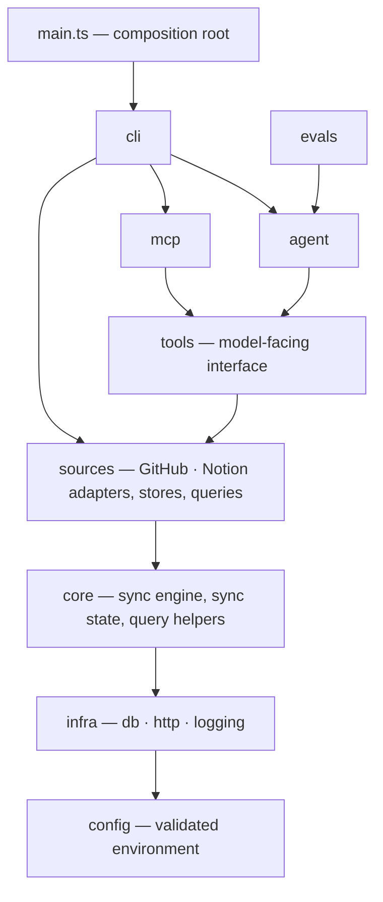

# Architecture

## Layers

Packages are layers. Each may import only from the layers below it (and from itself); the direction is **enforced by a test** ([`src/architecture.test.ts`](../src/architecture.test.ts)) that also rejects import cycles and cross-imports between data sources, so the structure can't erode silently.



| Package | Responsibility | Knows about |
| --- | --- | --- |
| `config/` | Parse + validate the environment once (Zod), and expose app identity (name, version, author, license) read from `package.json`. A leaf any layer may read. | nothing |
| `infra/db/` | Connection (WAL), `withTransaction`, versioned migrations (`PRAGMA user_version`). | config |
| `infra/http/` | The only outbound HTTP path: timeout, retries, `Retry-After`, typed `HttpError`. | config |
| `infra/logging/` | Append-only JSONL run history. | config |
| `core/sync/` | The `SyncAdapter` port, the sync engine (pagination, watermark, transactions, summary) and per-source sync state. | infra |
| `core/` | Query helpers shared by every source (`buildResult`, limit clamping, LIKE escaping), error formatting. | infra |
| `sources/<name>/` | One data source: `adapter` (fetch + validate a page), `store` (persist), `queries` (read-only reads). | core, infra |
| `sources/index.ts` | Registry of syncable sources — the only file that knows all of them. | sources |
| `tools/` | `defineTool` framework, the per-source tool definitions the *model* sees, and the registry. | sources, core |
| `mcp/` | Adapts the registry to MCP. No logic of its own. | tools, config (app identity) |
| `agent/` | Tool-use loop against the Messages API. Works on whatever tools it is handed. | tools (framework only) |
| `evals/` | Cases, deterministic fixtures, pure scoring, runner. | agent, tools, sources |
| `cli/` | Command parsing and exit codes. | everything above |

Two decisions the layering encodes:

- **`sources` never import `tools`.** Data access is independent of how it is presented to a model. Tool descriptions are prompt-engineering artifacts that change for different reasons than SQL queries do, so they live one layer up (`tools/github.ts`, `tools/notion.ts`).
- **`core/sync/adapter.ts` has no imports.** Sources implement a contract rather than depend on the engine that drives them.

### Adding a source

1. `core` needs no change. Create `sources/<name>/{adapter,store,queries}.ts` and add its table in a **new** migration (`infra/db/migrations.ts` — never edit a shipped one).
2. Implement `SyncAdapter` (`fetchPage`, `parse`, `upsert`) — see `sources/github/adapter.ts`. Return records newest-modified-first.
3. Register it in `sources/index.ts` (one entry: token name + `runSync(...)`).
4. Add `tools/<name>.ts` with its tool definitions and append them in `tools/registry.ts`.
5. Add its cases to `evals/cases.ts` and fixtures to `evals/fixtures.ts`.

`architecture.test.ts` tells you if a step put a dependency in the wrong place.

## Sync algorithm

```
state = load(source)                     # watermark, lastSuccessAt, unfinished pass
resume the saved pass if it exists and has the same mode (full/incremental), else start one
for page in pages(maxPages):
    records = adapter.fetchPage(cursor)  # newest-modified first — contract
    BEGIN
      for r in records:
        r' = adapter.parse(r)            # null → skipped++ (malformed)
        if r'.modifiedAt < watermark: stop   # strictly older → all remaining are synced
        adapter.upsert(r')               # atomic ON CONFLICT DO UPDATE
    COMMIT (or ROLLBACK the whole page)
    merge page counters into the summary   # only after COMMIT
    stop if: hit watermark | no next cursor | error
complete = hit the watermark or reached the end of the data
if complete and full and the pass touched something:
    adapter.prune(pass start time)       # delete records no run of this pass touched
if no errors:
    complete → watermark = newest modifiedAt of the WHOLE pass; clear the saved pass
    otherwise (page budget ran out) → save {cursor, start time, newest, mode, fetched}
    lastSuccessAt = now
append summary to sync-history.jsonl
```

Invariants:

1. **The watermark never moves past data we didn't see.** It changes only when a pass completes; a partial pass saves a cursor instead, and an error keeps the previous state.
2. **`<` not `<=` at the cutoff.** Equal timestamps are re-processed. Notion rounds `last_edited_time` to the minute; `<=` would drop an edit made in the same minute as the previous sync. Idempotent upserts make the overlap free.
3. **A summary never claims rows that were rolled back.** Page-local counters merge after COMMIT.
4. **A logging failure never fails a sync that worked.**
5. **Only a complete full pass may delete.** "Not touched since the pass began" means "deleted upstream" only if every upstream record was touched. Using the pass start time (not a set of keys) makes this work when the pass spans several runs. An incremental, unfinished or failed run never prunes, and a pass that touched nothing is refused outright.

## Data model

`repos`, `notion_pages`, `sync_state(source, watermark, lastSuccessAt)`. Two clocks are deliberately separate: `watermark` is an *upstream* timestamp (drives the incremental cutoff); `lastSuccessAt` is *our* wall clock (drives the freshness stamp shown to the agent). Deriving "last sync" from a result row would conflate them, and be wrong for filtered queries.

Migrations are append-only SQL in `infra/db/migrations.ts`; version `n` is stored in `PRAGMA user_version`. Migration 1 uses `IF NOT EXISTS` so databases created before versioning existed are adopted without data loss (covered by a test that builds the legacy schema by hand). A database newer than the build is refused rather than guessed at.

## Decision records

**SQLite via `node:sqlite`.** One file, transactional, zero services, and no native build step (unlike `better-sqlite3`, which compiles a native addon). WAL lets the MCP server read while a sync writes. Trade-off: a single writer, which this workload doesn't strain.

**Tools read a local snapshot, never the upstream API.** Latency and availability decouple from GitHub/Notion; rate limits can't be triggered by a chatty model; the blast radius of a hijacked agent is "read data you already synced". Trade-off: staleness, surfaced explicitly as `lastSyncAt` and a `note` when a source has never synced.

**One tool definition, three consumers.** The MCP server, the agent and the evals all read `TOOLS`. An eval can therefore never exercise a tool the server no longer exposes.

**Raw `fetch` for the Anthropic API instead of the SDK.** The project already owns a retry/timeout client; reusing it keeps one policy for every outbound call and one less dependency. Trade-off: no SDK conveniences (streaming helpers, typed responses) — responses are validated with Zod instead.

**Strict at the boundary, tolerant inside.** External and LLM-produced data is validated (Zod) at the edge. One bad record is skipped and counted; a wrong response *envelope* aborts, because that means the integration itself is broken.

**Ranked full-text search in SQLite (FTS5), not a search service.** External-content FTS5 tables index repository name/description/topics and Notion titles, kept in step by triggers, weighted with BM25 (name > description > topics) and tokenized with the Porter stemmer. It adds no dependency and works offline. Two consequences: `notion_pages` carries an `AUTOINCREMENT` surrogate key (an external-content index needs an integer rowid that never changes, which a `TEXT` primary key cannot provide), and the query builder quotes every word so untrusted text cannot inject FTS operators. Substring matching remains as a fallback because a word index cannot see inside words.

**Hybrid search with reciprocal rank fusion.** Lexical BM25 scores and cosine similarities live on unrelated scales, so they are fused by rank (RRF, k = 60) rather than by weighting scores — nothing to calibrate, and an item both rankings like beats one only a single ranking loves. Embeddings sit behind an `EmbeddingProvider` port (Voyage today) and are stored as float32 BLOBs in SQLite, unit-normalized so a dot product is the cosine; at personal scale a brute-force scan over a few thousand vectors takes milliseconds and avoids a vector database. The indexer embeds only new or edited documents (by text hash), keeps each committed batch on failure, and re-embeds everything when the model changes, since vectors from different models are incomparable. Semantic ranking is an enhancement, never a dependency: any failure degrades to the lexical result with an explanatory `note`.

**Structured tool output.** Tools declare an output schema derived from the same Zod types as their queries; the MCP server advertises it and returns `structuredContent` next to the text content (kept for hosts that ignore structured output). A contract test keeps the schema and the real output in agreement.

**Prompt caching in the agent.** The system prompt and tool definitions are identical on every turn, so they are marked as cache breakpoints. This is a cost/latency optimization only — prompts below the minimum cacheable length are not cached and nothing fails.

**Evals are a manual gate.** They cost money and are nondeterministic, so they don't run in CI. Their scoring logic is pure and unit-tested, and a test asserts every eval expectation is actually producible from the fixtures, so a broken eval fails fast without a model call.

**Biome over ESLint + Prettier.** One tool, one config, no dependency on the TypeScript compiler API (the project is on the native TS 7 compiler).

**At-least-once over exactly-once.** Exactly-once against an API with second/minute timestamps isn't achievable without upstream change feeds; at-least-once with idempotent writes is the honest, simple alternative.

## Failure modes

| Failure | Behaviour |
| --- | --- |
| Upstream 429 / 5xx | Retry, honoring `Retry-After`; then a counted error, watermark untouched. |
| GitHub primary rate limit (403 + `X-RateLimit-Remaining: 0`) | Wait for `X-RateLimit-Reset`, up to 60 s; longer waits fail fast with a counted error. |
| Sync cycle fails in worker mode | Logged; the worker continues with the next interval. |
| Upstream 401 / 404 | Not retried; counted error, exit code 1. |
| Network error / timeout | Retried with backoff + jitter; rethrown once exhausted. |
| Malformed record | Skipped and counted; run continues. |
| Wrong response envelope | Run aborts with an error. |
| Write fails mid-page | That page rolls back; earlier pages stay committed; watermark untouched. |
| Page budget exhausted | Flagged `capped`; the pass is saved and the next run resumes from its cursor; watermark untouched. |
| Model sends bad tool args | Validation error returned to the model as a tool error; loop continues. |
| Model loops on tools | Stops at `maxTurns` (default 6); CLI exits 1. |
| Older DB / newer DB | Migrated forward / refused. |
